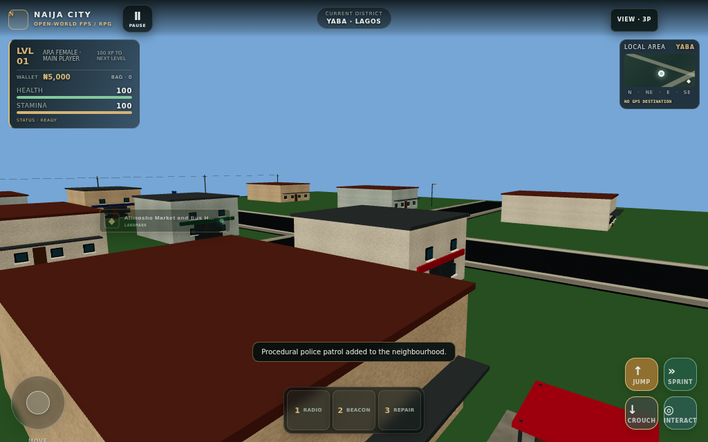
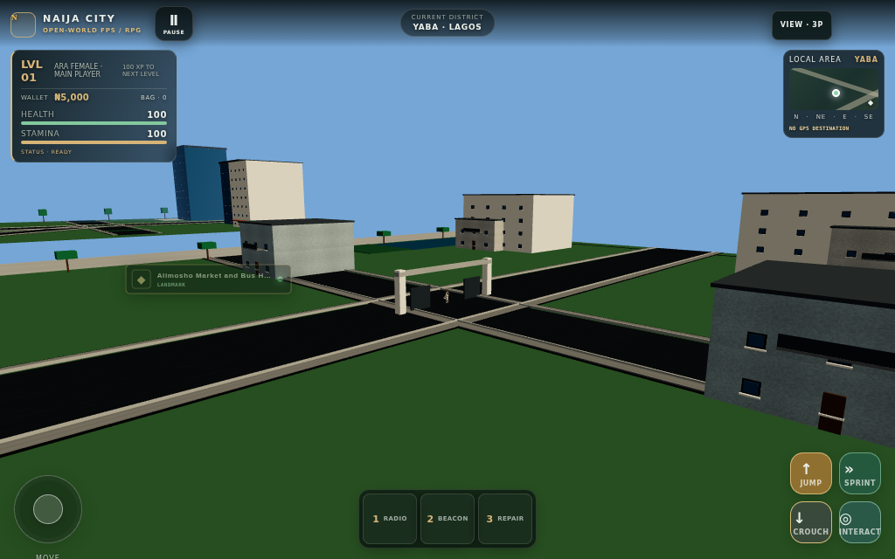
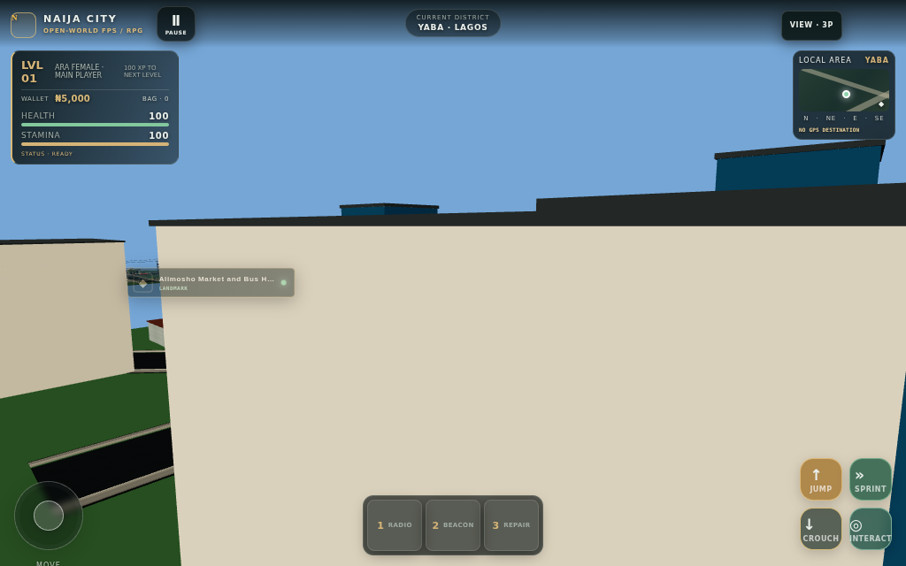
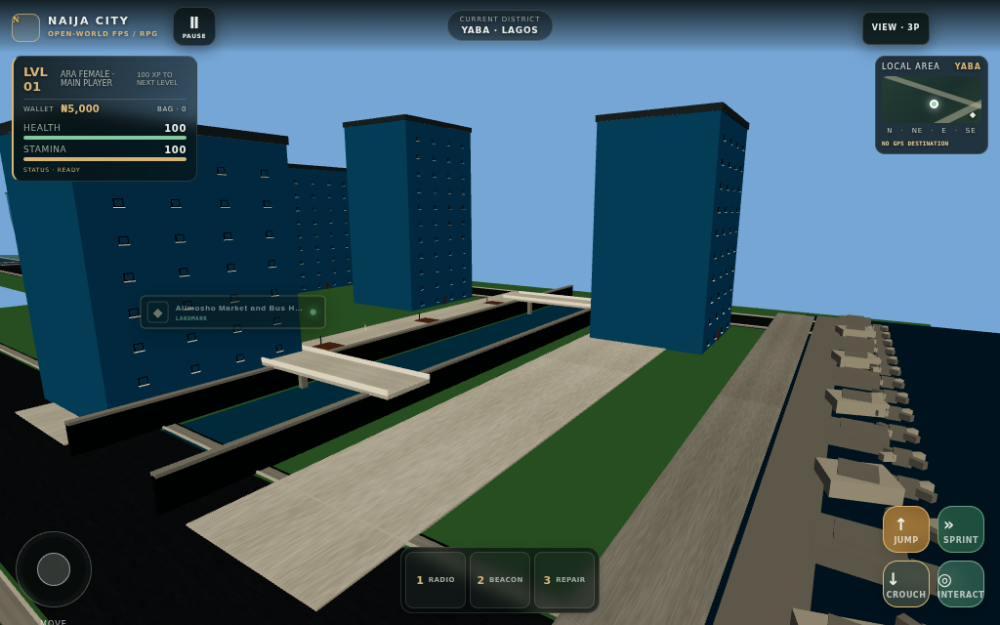
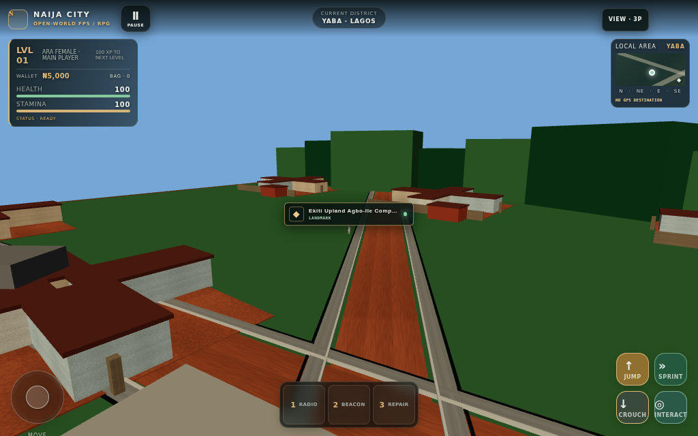

# Stage 08L — Five-district playable exterior rollout

**Status:** Implemented on the Stage 08L development branch; validation in progress
**Base:** Stage 08K Yaba heritage frontage slice
**Engine:** PlayCanvas, shared static-box batching, player/vehicle collision and proximity-managed district roots

## 1. What this stage delivers

Stage 08L adds five connected, walkable exterior neighbourhood slices to the existing Yaba–Ikeja core. The work is intentionally a district-scale vertical slice, not a claim that the whole metropolitan areas have been reconstructed.

| District | Authored identity | Included street/environment kit |
|---|---|---|
| Alimosho | Residential and local-centre fabric | Six face-me-I-face-you rooming-house blocks, four shopfronts, eight market stalls, bus-terminal apron/shelter, open drains, grates, utility poles and overhead-line silhouettes |
| Lekki | Gated estate edge and low-lying coastal landscape | Six estate villas, two apartment blocks, three retail fronts, opened gate approach, wetland retention pond, reed bed, mangrove buffer and estate drains |
| Victoria Island | Commercial/hospitality corridor with older side-street fabric | Three office towers, two hotels, one converted older bungalow, landscaped boulevard, street trees, parking-bay marks and public plaza |
| Eko Atlantic | Planned waterfront/canal environment | Four office towers, 18m stylized canal, two sheet-pile canal walls, two bridge decks, two promenades, four marina pontoons, 12 revetment armour segments and 18 low-poly tetrapod silhouettes |
| Ekiti uplands | Courtyard-compound settlement and upland landscape | Five Agbo-Ile courtyard compounds, 20 room wings, laterite road links, eight green ridge forms, ten granite-rock outcrops and broadleaf tree groups |

The district names and five authored landmarks are registered in the city identity records and shown on the expanded world map. The map now covers the new world bounds and draws the five connecting road links from the existing Yaba–Ikeja network.

## 2. Spatial plan and movement

The new district centres are deliberately separate and connected with clear arterial links:

| District | Centre X/Z (metres) |
|---|---:|
| Alimosho | -250 / 390 |
| Lekki | 250 / 270 |
| Victoria Island | 250 / 45 |
| Eko Atlantic | 500 / 45 |
| Ekiti uplands | -250 / 650 |

Five connector roads tie the slices into the existing Ikeja collector edges and the adjacent district network. Their ground/verge modules provide walkable support between the existing map and the authored neighbourhood pads.

The player controller's Bullet and fallback movement limits were expanded to the new city bounds (X -620..620, Z -200..790). Player physics receives the new building collision proxies, road colliders and district ground supports. The vehicle's street-collider set receives the same authored collision data.

## 3. Mobile and rendering policy

- The five slices are separate scene roots; distant roots are enabled/disabled by distance from the player/vehicle.
- Root activation radius is 320m in low-memory mode and 460m on ordinary devices, with a 60m release hysteresis to avoid flicker.
- District detail uses four shared 64×64 surface maps (worn asphalt, painted plaster, galvanized metal and laterite) instead of many per-building textures.
- Static opaque box components are left eligible for the existing Stage 08Q spatial-cell batching pass. Dynamic/interactive components remain excluded by the existing batching policy.
- Optional small detail is reduced in low-memory mode: fewer mangrove and upland trees.
- Camera far clip is 520m in low-memory mode and 680m otherwise.

This is a memory-conscious foundation. It does not yet implement per-building GLB LOD streaming for these five areas, live district NPC vendors, moving traffic routes, enterable building interiors or a dynamic coastal water simulation.

## 4. Art direction and research basis

**Alimosho.** LASBCA publishes an Alimosho Model City Plan alongside the Revised Ikoyi–Victoria Island and Lekki planning resources. The in-game slice translates the plan's residential/mixed-use and local-centre context into rooming-house rows, small shopfronts, an open market cluster and a transport stop. The exact streets and buildings are fictionalized, not copied property by property.

**Lekki.** The peninsula is a low-lying coastal barrier landscape with rapid urbanization and ecological assets including mangroves and swamps. The slice uses gated housing as one recognizable built form while retaining a wetland/retention edge and visible drainage; it deliberately avoids presenting the entire peninsula as uniformly reclaimed dry land.

**Victoria Island.** The slice combines a commercial boulevard and hospitality blocks with a single converted older bungalow and planted public space. This is intended to avoid the inaccurate visual shorthand of a continuous high-rise canyon.

**Eko Atlantic.** The waterfront is distinct from the existing VI slice: it has a planned boulevard, canal quay walls, bridge crossings, promenade and rock-armoured sea-defence edge. The canal and armour shapes are low-poly visual interpretations of the published ESIA/infrastructure typologies, not engineering-grade reconstructions.

**Ekiti.** The upland slice intentionally changes the skyline and ground palette: compact shared courtyards, laterite paths, green ridge silhouettes and granite outcrops. Ekiti's undulating upland terrain and exposed rock formations are documented in geological and regional descriptions; its modern housing fabric is varied, so the compounds are one local typology rather than a claim that all Ekiti homes follow one historic plan.

## 5. Important fidelity limits

1. The new buildings and street props are presently authored from reusable procedural box geometry and shared materials. The 258-model CC0 asset library remains available as an import foundation, but Stage 08L does not yet replace every procedural object with final, district-specific sculpted GLBs.
2. The district slices are exterior-playable and collision-connected. They are not complete neighbourhood simulations. No live traffic or vendor AI, enterable shops/houses, fully furnished interiors, utility simulation or full district missions are claimed.
3. The map uses a compact game scale to make the slices reachable. It is not a geospatially accurate map of Lagos or Ekiti.
4. Software-rendered Chromium/SwiftShader results are diagnostic only. A real Android device pass is still required for frame-time, thermal, memory-pressure and touch-control acceptance.

## 6. Research references

- Lagos State Building Control Agency, [Resources and Development Plans](https://lasbca.lagosstate.gov.ng/resources/) — official listing for Alimosho Model City Plan, Revised Lekki Scheme 1 Master Plan and Revised Ikoyi–Victoria Island Model City Plan.
- Obiefuna et al. (2021), [Flood risks to urban development on a coastal barrier landscape of Lekki Peninsula](https://doi.org/10.1016/j.sciaf.2021.e00787), *Scientific African* — coastal-barrier morphology, low-lying land, mangroves, swamps and flood exposure.
- African Development Bank, [Eko Atlantic ESIA/ESMP Summary](https://www.afdb.org/fileadmin/uploads/afdb/Documents/Environmental-and-Social-Assessments/Nigeria_Eko_Atlantic_ESIA_ESMP_Summary.pdf) — seawall, armour units, canal quay-wall and bridge typologies.
- Eko Atlantic, [Infrastructure](https://www.ekoatlantic.com/about/infrastructure) — developer description of the Great Wall, promenades and marinas.
- NEITI, [A Survey of the Solid Minerals Landscape and Endowments in Nigeria](https://www.neiti.gov.ng/INFORMATION/Ocassional%20Papers/NEITI-OPS6-A-Survey-Solid-Minerals-Landscape-Endowments-in-Nigeria-310120.pdf) — Ekiti's upland terrain and granite/gneiss outcrops.
- [Hydrochemical and stable isotopic characterization of shallow groundwater in the Ekiti area](https://link.springer.com/article/10.1007/s13201-013-0076-3) — undulating topography and inselberg/ridge forms in the Ekiti basement-complex terrain.
- [Afrocentric Placemaking and Architecture in Yoruba settlements](https://core.ac.uk/download/pdf/288926419.pdf) — historical compound morphology and courtyard settlement references.
- [Documentation of Local Architectural Vocabularies for Residential Building Components in Yoruba Cultures](https://doi.org/10.33003/fjs-2021-0601-2037) — Yoruba residential component vocabulary.
- [A Documentation Review of Yoruba Indigenous Architectural Morphology](https://doi.org/10.7176/jaas/66-05) — room modules, compounds, courtyards and material patterns.

## 7. Automated validation results

The full project verification, production build and browser suite completed successfully after updating the previous Yaba–Ikeja-only bounds assertions for the expanded world.

- Stage 08L runtime test: **PASS**; all five district roots activated at their test positions, and all five ground probes returned valid walkable surfaces.
- District map: five new landmark records; 55 total world-map records.
- Connector network: five inter-district connectors and ten local road segments; 15 road surface colliders and five district ground zones.
- Static rendering: 1,982 tagged district render components; 1,810 assigned to the existing spatial static-batching system; 96 total batches in the all-district runtime audit. The remaining 172 are not silently forced into batches.
- Collision/streaming: district roots are proximity-managed with 320m low-memory / 460m standard activation and 60m release hysteresis.
- Browser console/page errors: **none** in the Stage 08L runtime run.

The separate low-memory browser soak used a simulated 3 GiB / 4-core touch profile for about 20.5 seconds. It recorded p50 200ms, p95 466.7ms and a 1,283.3ms maximum frame interval, with 34.4MB heap growth. This is software-rendered Chromium/SwiftShader, not a real Android measurement. Those frame timings are not acceptable evidence of smooth mobile gameplay; the current slice still needs further optimization and a physical-device acceptance run before it can be called mobile-optimized.

## 8. Visual review captures

These captures are from the Stage 08L runtime smoke scene, not concept renders.

## 9. Next production work

Before expanding detail density further, profile the five districts on the target Android device and improve the low-memory frame budget. Follow-on content should replace the most visible procedural blockouts with authored, district-specific GLBs and decals, then add district traffic, vendors, enterable interiors and interactions. The present stage is the playable geographic and architectural foundation, not the final art pass.
